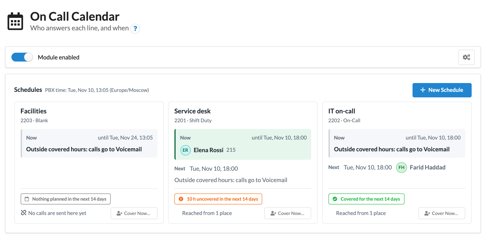
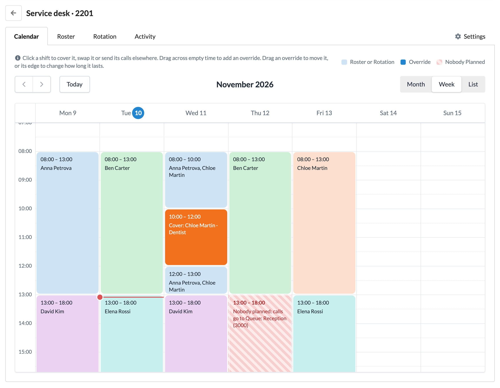
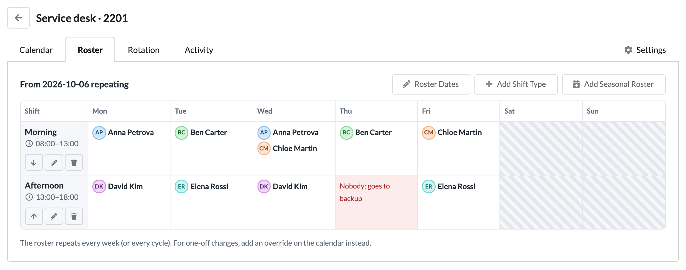
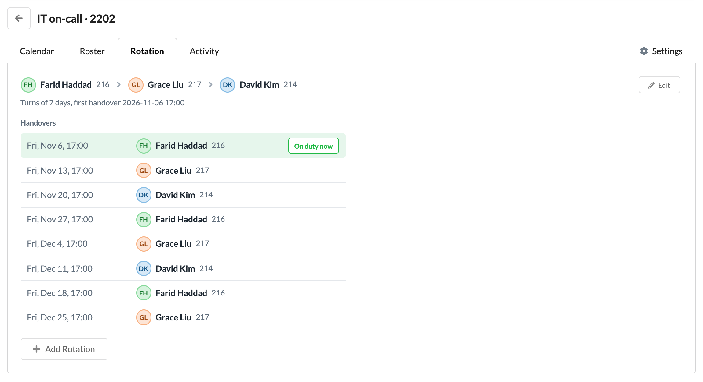
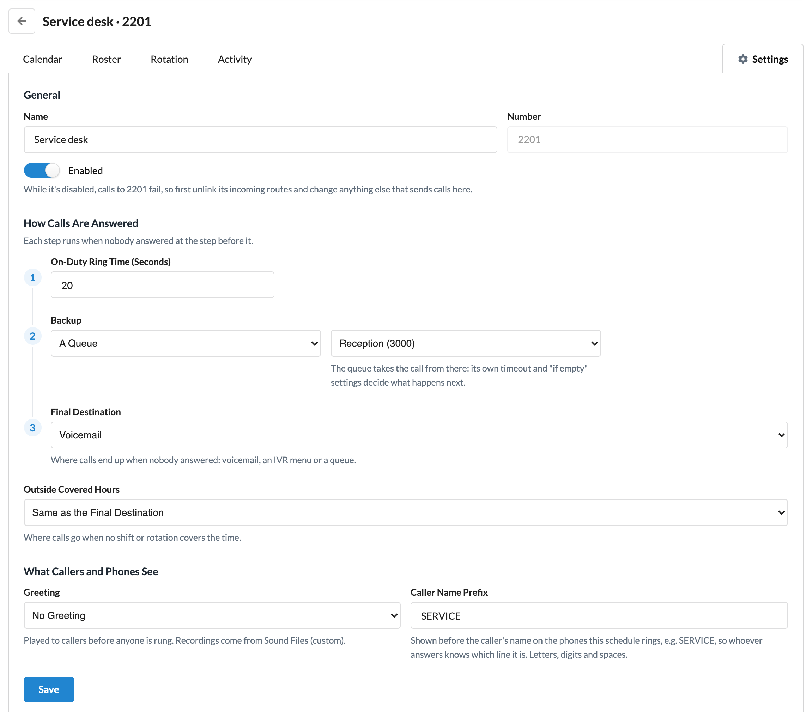
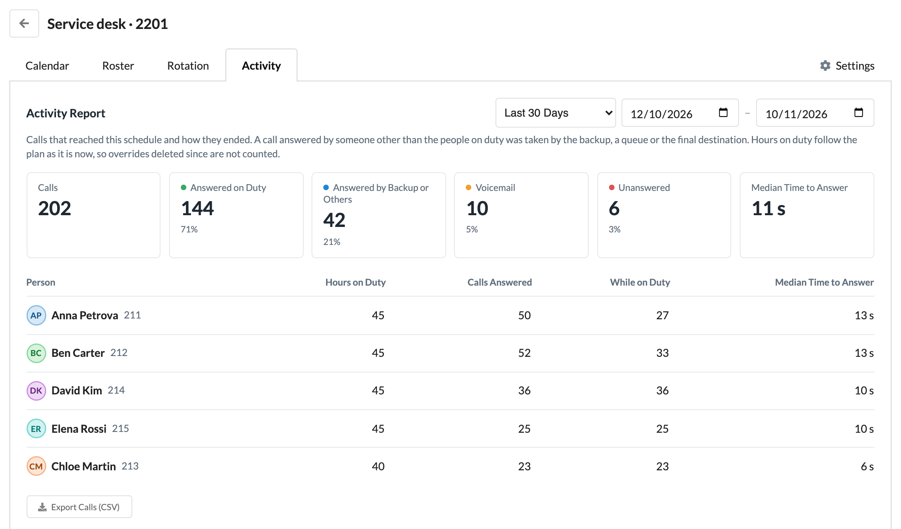
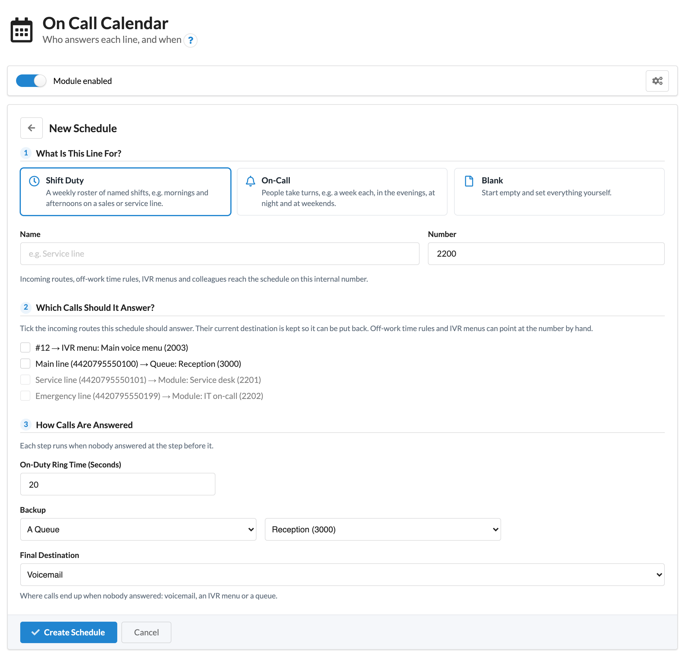

# On Call Calendar for MikoPBX

**Module ID:** `ModuleOnCallCalendar`

A MikoPBX extension module that decides, from a calendar, who answers each phone line and when, and what happens if that person doesn't pick up. It covers two everyday needs with one design:

- **Shift duty:** "The Service line rings Anna in the morning and Ben in the afternoon. If they don't answer, it goes to the Service queue."
- **On-call:** "After hours, the emergency number rings whichever technician is on call this week. If they don't answer, it rings the backup, then voicemail."

> Download the latest version from the [Releases page](https://github.com/eneuen/ModuleOnCallCalendar/releases). What changed in each version is in [CHANGELOG.md](CHANGELOG.md).

## Screenshots

The screenshots show a test PBX with simulated calls; the names and numbers are made up.

<table>
  <tr>
    <td width="50%" valign="top">
      
       <b>Calendar.</b> Who is on duty in the PBX's time zone: planned shifts in each person's colour, overrides solid, gaps striped. Click a shift to cover, swap or redirect it.
    </td>
    <td width="50%" valign="top">
      
       <b>Roster.</b> Who works which shift on which weekday; several people in one cell ring together, and an empty cell goes to the backup.
    </td>
  </tr>
  <tr>
    <td width="50%" valign="top">
      
       <b>Rotation.</b> People take turns every few days, within active hours such as evenings, nights and weekends.
    </td>
    <td width="50%" valign="top">
      
       <b>Settings.</b> How long the people on duty ring, the backup, the final destination, a greeting and a caller name prefix.
    </td>
  </tr>
  <tr>
    <td width="50%" valign="top">
      
       <b>Activity.</b> How calls ended and who answered them, for any period of up to three months, with a CSV export.
    </td>
    <td width="50%" valign="top">
      
       <b>New Schedule.</b> A template, a name and a number, and the incoming routes it should answer, in a few steps.
    </td>
  </tr>
</table>

## Requirements

- MikoPBX 2026.6.34 or later.

## Installing

1. Download `ModuleOnCallCalendar-<version>.zip` and its `.sha256` file from this repository's **Releases** page. Use that zip: the "Source code" downloads GitHub adds to each release are for developers and can't be installed.
2. Check the download against its checksum, for example with `shasum -a 256 -c ModuleOnCallCalendar-<version>.zip.sha256` (macOS or Linux).
3. In the MikoPBX admin cabinet, open **Modules**, upload the zip, then enable the module.

On Call Calendar appears in the sidebar for admins. No call changes until a schedule exists and something sends calls to its number.

## How it works

Each **schedule** gets its own internal number. Incoming routes, off-work time rules, IVR menu options and colleagues send calls to that number like to any other destination; it appears in MikoPBX's destination lists as "Module: <schedule name> (<number>)".

When a call arrives, the module rings whoever is on duty at that moment. If nobody answers, the call follows the schedule's if-no-answer chain:

1. **The person or people on duty**, ringing together for the schedule's ring time. Their own call forwarding and voicemail are skipped for this call, so the backup always gets its turn. Busy or offline phones are skipped at once.
2. **A backup** (optional): another person, rung the same way, or a queue. A queue takes over the call from there, and its own timeout and if-empty settings decide what follows.
3. **A final destination:** MikoPBX's voicemail, an IVR menu, a queue or any other number.

Calls rung by the module are ordinary MikoPBX calls: each leg appears in call history and is recorded under the PBX's recording settings.

Who is on duty is kept in Asterisk's database and read when a call arrives, so changing the plan never reloads the dialplan. If that information is missing or out of date (for example while the module's worker is restarting), the call works out who is on duty from the plan itself; only if that fails too does it go to the backup and then the final destination, rather than to someone who may no longer be on duty.

## Using it

Open **Modules → On Call Calendar** (administrators, and access groups given rights; see below).

1. **New Schedule:** choose a template, a name and a number, and tick the incoming routes this schedule should answer. **Shift Duty** starts with Morning and Afternoon shifts on weekdays; **On-Call** starts with a rotation in the evenings, at night and at weekends.
2. **Plan who is on duty:** fill the **Roster** grid (who works which shift on which weekday; several people in one cell ring together), or set up the **Rotation** (people take turns every few days). A roster can repeat over up to four weeks for alternating patterns.
3. **Handle exceptions on the Calendar:** click a shift to have someone cover it, swap it with someone else's shift, or send its calls elsewhere; drag across empty time to add one. Changes take effect within seconds, without reloading anything.

The home page shows who is on duty on every line right now, who is next, and where nobody is planned.

All times on the page are the PBX's own time, in the time zone set in MikoPBX's general settings, whatever the browser's time zone is.

**Settings.** Each schedule's Settings tab sets its name and number, whether it's enabled (while it's disabled, calls to its number fail), and the if-no-answer chain: how long the people on duty ring, the backup, the final destination, and where calls go outside covered hours. It can also play a greeting from Sound Files before anyone is rung (the caller isn't answered, so not charged, until someone picks up), and put a prefix such as `SERVICE:` before the caller's name on the phones it rings. A roster or rotation can have its own backup, for example a night rotation with no backup on a line whose daytime roster falls back to a queue. **Test Call** rings a phone you choose and, once you answer, calls the schedule through its real chain.

**Activity.** Each schedule's Activity tab has a report for any period of up to three months: how many calls arrived, how many were answered by the person on duty, by the backup or others, went to voicemail or were not answered, the median time to answer, and per person their hours on duty and the calls they answered. The calls can be exported as CSV. Below it is the change log: who changed what, and when.

**Taking over from a phone.** A member of a schedule can dial **\*22** to be on duty from now until the plan next changes (the next handover or the end of the shift, at most a week), for example to cover a colleague who has to leave early. Someone in several schedules dials \*22 followed by the schedule's number, e.g. \*222202. A beep and "thank you" confirm it; an error tone means they are not a member of that schedule. The take-over appears on the calendar like any other override and can be moved or deleted there.

## Incoming routes

Linking a route from the module (in the wizard or under **Settings**) points it at the schedule's number and remembers what it pointed at before; **Unlink** puts it back. The module also raises the route's timeout so the whole chain fits: MikoPBX stops a route's call at that timeout and moves on to the route's next rule. The timeout leaves 30 seconds to spare but doesn't count a greeting's length, so with a greeting longer than that, raise the route's timeout on its own page.

Off-work time rules, IVR menu options and employees' forwarding can send calls to a schedule's number too; set those on their own pages. A typical on-call setup keeps the daytime route as it is and points an off-work time rule at the on-call schedule.

While the module is disabled, calls to a schedule's number fail. Before disabling it for more than a moment, unlink its routes and change anything else that points at a schedule's number.

## Disabling and uninstalling

Disabling removes the schedules' dialplan; enabling brings it back as it was. Uninstalling with **keep settings** keeps the schedules, plans and call log for a later reinstall. Without it, the incoming routes the module linked are put back as they were, the schedules are deleted, and their numbers are released in MikoPBX. A number that something else points at (a route set by hand, an off-work time rule, an IVR option or someone's forwarding) can't be released and stays registered, so change those first; the system log names any number kept.

## Who can use it

Administrators can do everything. Other people can be given access through an access group, with MIKO's **Access control management** module: in the group's rights, the module's page (`ModuleOnCallCalendar`) lists its actions by name. Tick the actions for the rights the group should have:

| Right | For | Actions to tick |
| --- | --- | --- |
| **View** | Staff who go on duty: see who is on duty, the calendar, rosters, the activity report and the change log | `index`, `overview`, `schedule`, `calendar`, `options`, `report`, `audit` |
| **Edit Duty** | Office managers and team leads: plan who is on duty (with View) | `saveShiftType`, `deleteShiftType`, `orderShiftTypes`, `saveRoster`, `deleteRoster`, `setCell`, `saveRotation`, `deleteRotation`, `orderRules`, `addOverride`, `addSwap`, `updateOverride`, `deleteOverride`, `removeMember` |
| **Edit Settings** | Whoever may change where calls go (with View and Edit Duty) | `createSchedule`, `updateSchedule`, `deleteSchedule`, `setRuleBackup`, `linkRoute`, `unlinkRoute`, `testCall` |

Edit Duty changes who answers, never where calls can go: people are always employees with an extension, and **Send Calls Elsewhere** only offers the schedule's own destinations. The page shows each person only the controls their rights allow, and the module checks every request again.

## Development

See [CONTRIBUTING.md](CONTRIBUTING.md) for the setup, the checks, how calls are routed and how a release is made.

## Licence

GPL-3.0-or-later. See [LICENSE](LICENSE).
